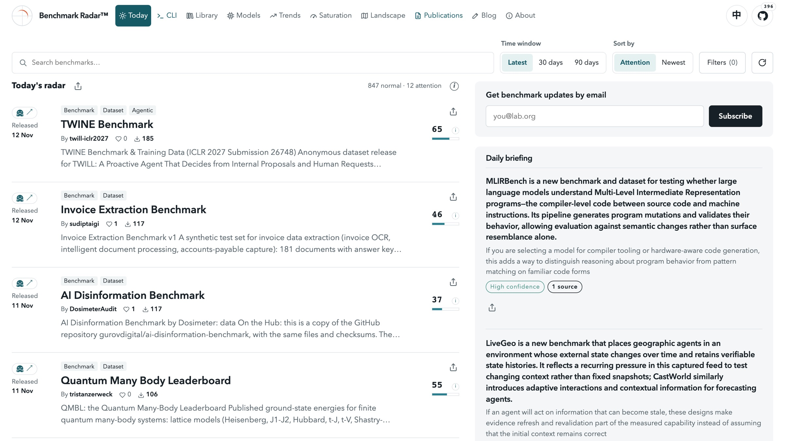
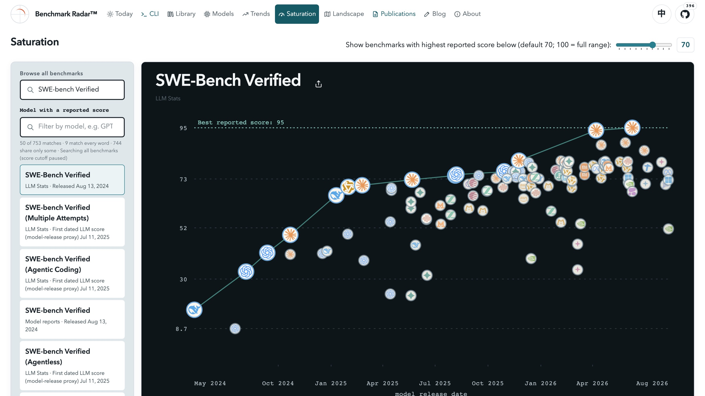
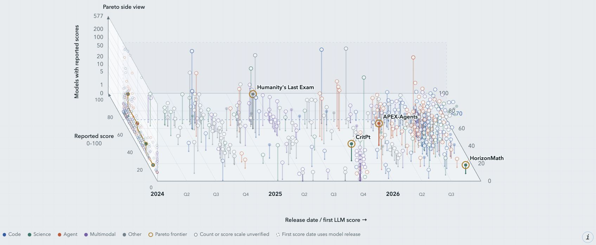
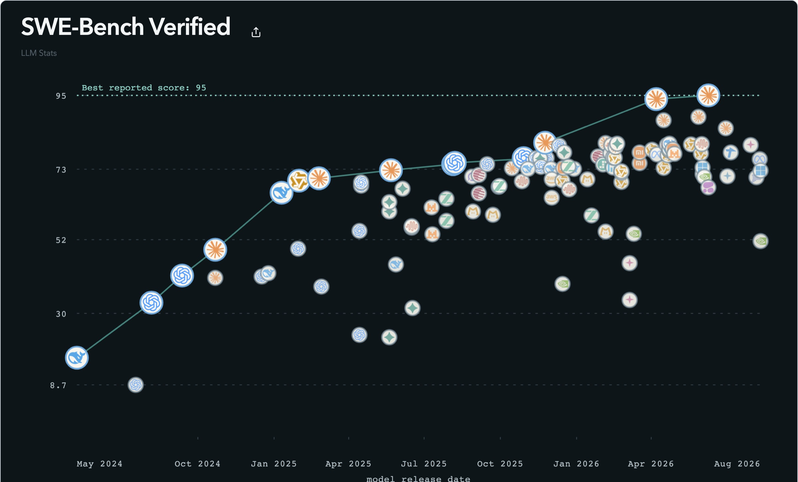

# Benchmark Radar: Keeping a Living Map of AI Evaluation

Cohere Labs Open Science Community · Koutian Wu, UT Austin · benchmark-radar.org

---

## 1. Benchmark Radar

- Cohere Labs Open Science Community
- Keeping a Living Map of AI Evaluation
- Koutian Wu · M.A. candidate in AI for Sciences, UT Austin
- Koutian Wu\*, Wenjun Zhang\*, Junjie Zhou, Pengqian Han, Qiming Bao, Ergan Shang, Jiayu Wang, Junkai Wang, Wanghan Xu, Songyuanyi Lu, Yixuan Li, Rudy Mizrahi Celekli, Lazizbek Ravshanov, Yaoliang Bian, Xudong Han, Lin Shi
- \*Equal contribution to the paper and the code.
- benchmark-radar.org · ktwu@utexas.edu

> **Speaker notes:** Thank the host and Cohere Labs. One sentence on who I am. Benchmark Radar is the work of the sixteen people on this slide. Today: what a living record of AI benchmarks shows, and a method your team can use on Monday.

---

## 2. The problem

*Why this talk*

- 2,940 new benchmark releases in 90 days. No single place tracked what exists, who reported it, or how scores moved.
- Teams pick evals by habit. The familiar names win, not the ones that fit the product.
- Headline scores travel alone. The source, the reporter, and the date get dropped along the way.
- A wrong eval costs more than no eval. It gives a team confidence in the wrong direction.
- 2,940 = releases in Benchmark Radar's 90-day window, retrieved Nov 13, 2026 (scripts/release_repo_findings.py).

> **Speaker notes:** Open with the scale: Radar picked up 2,940 new benchmark releases in the last 90 days. Nobody reads that many. So teams fall back to habit, and a number reaches a slide without its source or date. The last bullet is the stake: a bad eval is worse than none, because it points the team the wrong way with confidence.

---

## 3. What Benchmark Radar is

*The project*

- 49,679 · benchmark records collected
- 41 · public sources, crawled daily
- 396 · GitHub stars
- 300+ · users
- Every record keeps its original source and its score history.
- Open: code on GitHub (pipeline MIT, web UI AGPL-3.0), dataset on Hugging Face (MIT; third-party data keeps its own terms).
- Records: benchmark-radar.org records badge, Nov 13, 2026. Stars: GitHub, Nov 13, 2026.

> **Speaker notes:** One line: a living database and search engine for AI benchmarks. The numbers are from today. 49,679 is records collected, not distinct benchmarks; many records point at the same benchmark from different sources. Everything is open: the code and the dataset.

---

## 4. Who is viewing and using it

*Reach*

- Researchers at OpenAI, Anthropic, Google, Meta, Microsoft, NVIDIA, Amazon, IBM, ByteDance, and Unitree viewed/using it.
- 300+ users across labs, companies, and universities.

> **Speaker notes:** Keep this short. The point is not the logos; it is that the people who build and report on benchmarks already look things up here. 37 institutions on the strip. Wording is deliberate: viewed or using.

---

## 5. How it works

*The pipeline*

- DiscoverNew benchmarks are found as they appear in papers, repos, datasets, and leaderboards.
- ExtractEach record keeps its original source, the reported score, who reported it, and the date.
- TrackScore history is followed over time, so new results and new versions stay visible.
- The live site: search at the top, today's new benchmarks ranked below, each linked to its source.

> **Speaker notes:** Three steps. Discover: 41 sources every day. Extract: the score never travels without its source, reporter, and date. Track: the history stays. The screenshot is the front door; the demo starts here.

---

## 6. Demo: Saturation

*Live demo*

- Saturation. The best reported score over time. When it flattens near the top, the benchmark stops telling models apart.
- Pareto frontier. Benchmarks that many models have tried and none has topped: still hard, and widely used.

> **Speaker notes:** Switch to the browser, Saturation page. Type SWE-bench Verified and open its score history: show where the best score flattens. Then show the Benchmark Frontier: the gold staircase marks the benchmarks that are still hard for the number of models tested on them. If the network fails, this screenshot is the fallback.

---

## 7. Benchmark Frontier

*Live demo*

Which difficult benchmarks have been tested most? Compare reported scores, release dates, and the number of models tested.

> **Speaker notes:** Same page, the Benchmark Frontier. Each stick is one benchmark: left to right is release date, depth is the best reported score, height is how many models have a reported score. The gold rings are the Pareto frontier: Humanity's Last Exam, APEX-Agents, CritPt, HorizonMath. No other benchmark has both a lower best score and more models tested.

---

## 8. Attention

*Finding 1 of 5*

- Repos with zero GitHub stars · 70%
- Stars held by the top 1% of repos · 78%
- Stars held by the top 10% of repos · 98%
- 1,024 GitHub repos behind 2,940 new benchmark releases from the last 90 days. Attention is a power law: a handful of benchmarks get almost all of it.
- Stars measure attention, not quality. The benchmark your product needs may be in the 70%.
- Benchmark Radar insights #1130, #1132; re-run Nov 13, 2026 on the 90-day window.

> **Speaker notes:** This is where the record starts to say something. Of the 1,024 repos we have facts for, 70% have zero stars. The top 1%, about ten repos, hold 78% of all stars. If your team discovers benchmarks through what is trending, you are sampling the top 1%. Careful: stars are attention, not quality.

---

## 9. Papers

*Finding 2 of 5*

- 8.5★ vs 0★ · median stars, repos with an arXiv paper vs without
- 21 of 29 · repos with 100+ stars have a paper
- 14% · of repos in the cohort have a paper
- This is an association, not a cause. A paper and stars can both come from a well-resourced team.
- For your team: a paper-less benchmark is not wrong, but its setup is harder to check.
- Benchmark Radar insight #1131; re-run Nov 13, 2026 (146 paper repos, 878 without).

> **Speaker notes:** Paper repos are one in seven of the cohort but 21 of the 29 that reached 100 stars. Say releases versus repos clearly: 2,940 releases come from 1,081 repos. Median 8.5 versus 0. Say the caveat out loud: association. The practical reading for industry: a paper makes the setup easier to check.

---

## 10. Abandoned repos

*Finding 3 of 5*

- 35% · never pushed again after the day they were created (363 of 1,024)
- 5.3% · of repos are gone or made private: GitHub returns 404 (57 of 1,081)
- A finished benchmark can be pushed once. One-day repos measure activity, not quality.
- A missing repo is a dead citation. Radar now lists gone and archived repos without ranking them.
- Benchmark Radar insights #1130, #1133. Gone = 404 on the GitHub repository endpoint, which follows renames.

> **Speaker notes:** One in three new benchmark repos never gets a second day of commits. And 57 of 1,081 repos are gone: a 404 on the endpoint that follows renames, so these are not renames. They were deleted or made private. If a decision rests on a benchmark, check that its repo still exists.

---

## 11. Saturation

*Finding 4 of 5*

- 16.8 → 95.0 · best reported SWE-bench Verified score, May 2024 → June 2026
- 65 of 111 · reported scores are 70 or higher
- Saturated is not solved. A crowded top means the test separates fewer models, not that the task is done.
- SWE-Bench Verified, LLM Stats leaderboard, Benchmark Radar Saturation page, Nov 13, 2026.

> **Speaker notes:** One leaderboard, LLM Stats, 111 reported scores. The best reported score went from 16.8 in May 2024 to 95.0 in June 2026, as dated by LLM Stats. 65 of the 111 are 70 or higher, so the top is crowded. Saturated does not mean solved; it can mean the test stopped measuring the hard part. These are reported scores from one source, not a cross-source saturation metric.

---

## 12. Audits

*Finding 5 of 5*

- SWE-bench Pro · 109 of 728 · public tasks underdetermined (15.0% floor); 3 gold patches fail the benchmark's own verifier. · Published June 21, 2026: 17 days before OpenAI's audit (July 8) estimated ~30% of tasks broken.
- Terminal-Bench 2.1 · 40 of 83 · gold-passing tasks still pass after a careless in-workspace deletion.
- DeepSWE · 4 of 113 · reference solutions fail their own verifiers (v1.0). The v1.1 re-grade fixed 3 of them.
- Radar lists 9 audits of 8 benchmarks, all by June Kim: also ProgramBench, MirrorCode, FrontierCode, SlopCodeBench, and Frontier-Bench.
- Findings as reported by each audit, linked from the benchmark's Radar record (june.kim, GitHub, Zenodo).

> **Speaker notes:** How a score was produced matters as much as the number. Independent audits re-run the setup. These are the audit's findings, not Radar's. SWE-bench Pro: at least 15% of public tasks underdetermined. June published this on June 21, 2026, 17 days before OpenAI's own audit on July 8 estimated about 30% of tasks broken. The two measure different defect types, so do not add or compare the percentages. Terminal-Bench 2.1: a careless deletion goes unnoticed on 40 of 83 tasks. DeepSWE: four reference solutions failed their own verifiers, and the v1.1 re-grade fixed three. Radar shows the audit next to the scores it examines. Credit June Kim.

---

## 13. A five-step check

*Take home*

- 01 · Finding 1 · Discover wide · Start from the full landscape, not from what is trending.
- 02 · Findings 2–3 · Check provenance · Find the paper, the repo, and who reported each score. Confirm the repo still exists.
- 03 · Finding 4 · Check saturation · Ask whether it still separates your candidate models.
- 04 · Finding 5 · Check audits · Look for an independent recheck before you rely on it.
- 05 · Schedule retirement · Decide in advance when the eval gets dropped, and write the date down.

> **Speaker notes:** Each step maps to a finding. Discover wide, because attention is a power law. Check provenance, because many repos go quiet or disappear. Check saturation. Check audits. Then schedule retirement: the step teams skip. Radar helps with the first four; the fifth is a team decision.

---

## 14. What is next

*Roadmap*

- Wider coverage. More sources, more benchmarks, and faster pickup of new releases.
- A deeper audit layer. More audit records linked to the scores they examine.
- Interop with community efforts. Radar's records should flow into shared efforts such as Every Eval Ever, not sit in a silo.
- Better history views. Score movement over time, readable at a glance.

> **Speaker notes:** Four directions. The audit layer is the one with the most leverage, and it depends on people like June Kim publishing audits. Interop: we would rather feed shared efforts than build a silo.

---

## 15. Let your agent draft Related Work

*For your paper*

- Install once. One command adds the Benchmark Radar Skill to your coding agent.
- Name your themes. Ask your agent for a Related Work section, one paragraph per theme.
- Get LaTeX and BibTeX. A cited Related Work draft and the missing BibTeX entries, ready to edit.
- `npx skills add ktwu01/benchmark-radar --skill benchmark-radar`

> **Speaker notes:** First ask, for anyone writing a paper. One command gives your agent the Skill to write a cited Related Work draft and the BibTeX to go with it. It searches the Radar catalog plus arXiv, Hugging Face Papers, Semantic Scholar, OpenAlex, and Crossref. Read every entry before you keep it.

---

## 16. Search for it. If it is missing, add it.

*For your benchmark*

- Search. 49,679 benchmark records from 41 public sources, one search box.
- Not there? Open the "Submit a benchmark" form on GitHub. English or Chinese is fine.
- Help the next team. Every benchmark you add is one more that others can find.
- benchmark-radar.org (screenshot: search for "agent")

> **Speaker notes:** Second ask. Search for the benchmark you built or the one you rely on. If Radar missed it, the form takes two minutes, and the next team will find it.

---

## 17. Get new benchmarks by email

*For your inbox*

- Open the homepage. The signup box sits next to the search results.
- Pick daily or weekly. Daily brings the latest each day; weekly arrives every Monday.
- Leave anytime. Every email has an unsubscribe link.
- No email needed. The same Daily briefing is on the homepage.
- benchmark-radar.org (screenshots: homepage email signup box; below it, the Nov 14, 2026 daily brief email)

> **Speaker notes:** Third ask. If you want to keep up without checking the site, the email brings new benchmarks to you, daily or weekly.

---

## 18. Get involved

*Join in*

- Use the dataset. The full record set is open: huggingface.co/datasets/ktwu01/benchmark-radar
- Contribute a benchmark. If Radar missed one you care about, adding it is a small issue.
- Report an error. A wrong score or a missing source is worth a flag.
- Publish an audit. Radar links it next to the scores it examines.
- Start at benchmark-radar.org. Code and issues: github.com/ktwu01/benchmark-radar
- QR codes: Discord (Benchmark Radar) and WeChat (Koutian Wu).

> **Speaker notes:** Concrete asks. The audit ask is new: if your team rechecks a benchmark, publish it and Radar will link it.

---

## 19. Questions

*Q&A*

- Which eval does your team trust most, and when did you last check it?
- I am looking for my next role in AI evaluation, starting Feb '27. If your team is hiring, or you can refer me, please email me: ktwu@utexas.edu
- QR codes: Discord and WeChat.
- Thanks to my co-authors and contributors: Wenjun Zhang, Junjie Zhou, Pengqian Han, Qiming Bao, Ergan Shang, Jiayu Wang, Junkai Wang, Wanghan Xu, Songyuanyi Lu, Yixuan Li, Rudy Mizrahi Celekli, Lazizbek Ravshanov, Yaoliang Bian, Xudong Han, and Lin Shi.

> **Speaker notes:** Say the job callout out loud, then leave this slide up for the whole Q&A. Read the acknowledgment. Thank Prahitha and Cohere Labs.
