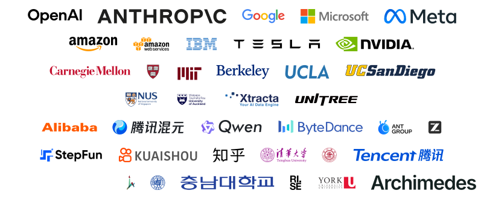
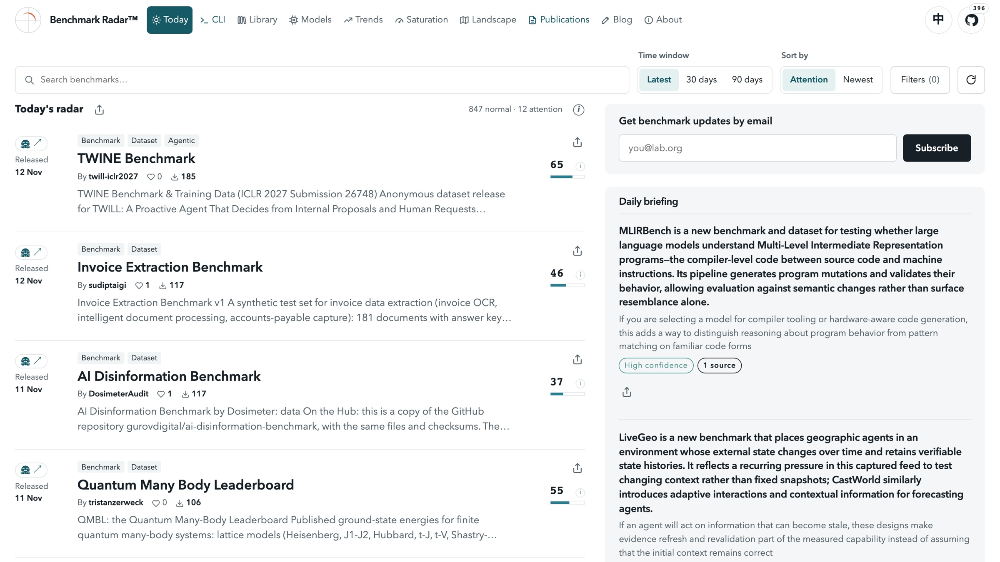
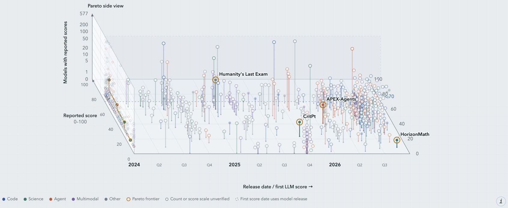
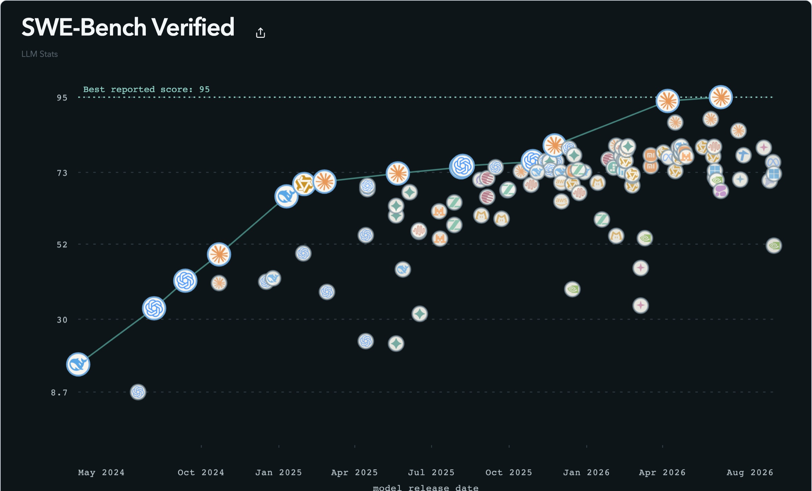

# Benchmark Radar: Keeping a Living Map of AI Evaluation

Cohere Labs Open Science Community · Koutian Wu, UT Austin · benchmark-radar.org

---

## 1. Benchmark Radar

- Cohere Labs Open Science Community
- Keeping a Living Map of AI Evaluation
- Koutian Wu · M.A. candidate in AI for Sciences, UT Austin
- Koutian Wu\*, Wenjun Zhang\*, Junjie Zhou, Pengqian Han, Qiming Bao, Ergan Shang, Jiayu Wang, Junkai Wang, Wanghan Xu, Songyuanyi Lu, Yixuan Li, Rudy Mizrahi Celekli, Lazizbek Ravshanov, Yaoliang Bian, Xudong Han, Lin Shi
- \*Equal contribution to the paper and the code.
- benchmark-radar.org · ktwu@utexas.edu

> **Speaker notes:** In the first 15 seconds, thank Prahitha Movva and Cohere Labs for hosting. One sentence on who I am. Benchmark Radar is the work of the sixteen people on this slide. Today: what a living record of AI benchmarks shows, and a method your team can use on Monday.

---

## 2. Before you build an eval: has anyone measured this already?

*Where it started*

- The answers are scattered. arXiv, GitHub, dataset pages, model cards, technical reports, leaderboards.
- A name is only the start. What does it measure? Is the code still up? Who reported scores, and under which prompt, tools, and attempts?
- And the pile keeps growing: 2,940 new benchmark releases in 90 days.
- Lin Shi, a core contributor to harbor-framework and Terminal-Bench, advised us and helped bring this work about.
- 2,940 = releases in Benchmark Radar's 90-day window, retrieved Nov 13, 2026 (scripts/release_repo_findings.py).

> **Speaker notes:** Start with the moment every benchmark researcher knows. You have an idea for an eval, and the first job is to check whether someone already measured it. The answers sit in six different places, and a benchmark name only opens more questions. Then the scale: 2,940 new releases in 90 days. We had not thought much about this until Lin Shi pushed us; credit Lin by name. Benchmark Radar began as a tool for our own research, because we wanted to follow benchmarks every day and the collecting was too repetitive.

---

## 3. Credit assignment: 225 leads, 2 papers

*A real case*

- Ask. Jiayu Wang planned an eval and asked: does it duplicate August 2026 work on credit assignment in agentic training, with small Qwen baselines?
- Search. A coding agent installed the Radar Skill and ran several topic variants.
- Judge. Opening each paper left SRPO and HindSearch: August, credit assignment, small Qwen backbone, released code.
- Matches: 225 · matched every query word: 47 · dated August 2026: 38 · met all four conditions: 2.
- Radar finds the candidates and the evidence. The researcher judges what is relevant.
- Worked use case contributed by Jiayu Wang, Benchmark Radar technical report.

> **Speaker notes:** One real search, from our co-author Jiayu Wang. The question: is this new eval already done? The agent searched the catalog and the discovery layer: 225 matches, 47 matched every word, 38 from August. Then the human part: open each paper and check the four conditions. Two survived, SRPO and HindSearch. That split is the point of the whole project: the tool narrows the pile, the researcher makes the call. Now, what Radar is.

---

## 4. What Benchmark Radar is

*The project*

- 52,120 · benchmark records collected
- 41 · public sources, crawled daily
- 400+ · GitHub stars
- 300+ · users
- Every record keeps its original source and its score history.
- Open: code on GitHub (pipeline MIT, web UI AGPL-3.0), dataset on Hugging Face (MIT; third-party data keeps its own terms).
- Records: benchmark-radar.org records badge, Nov 17, 2026. Stars: GitHub, 409 on Nov 17, 2026. Sources: Nov 13, 2026.

> **Speaker notes:** One line: a living database and search engine for AI benchmarks. 52,120 is records collected, not distinct benchmarks; many records point at the same benchmark from different sources. Everything is open: the code and the dataset.

---

## 5. Who is viewing or using it

*Reach*

- Researchers at OpenAI, Anthropic, Google, Meta, Microsoft, NVIDIA, Amazon, IBM, ByteDance, and Unitree viewed/using it.
- 300+ users across labs, companies, and universities.

> **Speaker notes:** Keep this short. The point is not the logos; it is that the people who build and report on benchmarks already look things up here. 37 institutions on the strip. Wording is deliberate: viewed or using.

---

## 6. How it works

*The pipeline*

- Discover. New benchmarks are found as they appear in papers, repos, datasets, and leaderboards.
- Extract. Each record keeps its original source, the reported score, who reported it, and the date.
- Track. Score history is followed over time, so new results and new versions stay visible.
- The live site: search at the top, today's new benchmarks ranked below, each linked to its source.

> **Speaker notes:** Three steps. Discover: 41 sources every day. Extract: the score never travels without its source, reporter, and date. Track: the history stays. The screenshot is the front door; the demo starts here.

---

<!-- Hidden until the Benchmark Frontier has findings to present; remove this comment wrapper to bring the slide back.

## Benchmark Frontier

*Live demo*

Which difficult benchmarks have been tested most? Compare reported scores, release dates, and the number of models tested.

> **Speaker notes:** Switch to the browser, Saturation page, the Benchmark Frontier. If the network fails, this screenshot is the fallback. Each stick is one benchmark: left to right is release date, depth is the best reported score, height is how many models have a reported score. The gold rings are the Pareto frontier: Humanity's Last Exam, APEX-Agents, CritPt, HorizonMath. No other benchmark has both a lower best score and more models tested.

-->

## 7. Levels of benchmarks

*The map has floors*

| Level | Capability | Example task | Example benchmarks |
| --- | --- | --- | --- |
| 1 | Quiz questions | Answer one fact or one short problem | MMLU, GSM8K, HumanEval: top scores 87–97%, basically solved |
| 2 | Expert-level questions | Questions written to stump PhDs | Humanity's Last Exam, FrontierMath: under 10% at launch → about 50% today |
| 3 | Real coding work | Fix and build code in real projects | SWE-bench, LiveCodeBench: same models, 84–89% on toy code, 25–34% on real code |
| 4 | Long agent tasks | Use tools for hours to reach a goal | GAIA, OSWorld, Terminal-Bench: best AI finishes half of ~40-hour expert tasks |
| 5 | Whole jobs | Do paid work end to end | GDPval, Mercor Benchmark Map: about 90% of US work hours barely tested |
| 6 | Testing the tests | Check whether a score means what it claims | HELM, LMArena, validity studies: same-format tests can agree more than same-skill tests |
| 7 | Discovery | Nobel-level research in physics, biology, math | ResearchClawBench, PaperBench: known answers only, rediscovery and replication |

Sources:
1. Meta, Llama 3.1 405B Instruct model card (2024): MMLU 87.3, HumanEval 89.0, GSM8K 96.8. https://github.com/meta-llama/llama-models/blob/main/models/llama3_1/MODEL_CARD.md
2. Launch: HLE best 9.4% (Phan et al., Jan 2025, Table 1) https://arxiv.org/html/2501.14249v1 ; FrontierMath under 2% (Glazer et al., Nov 2024) https://arxiv.org/abs/2411.04872 . Now: HLE 54.8% (GPT-6 Astra, Scale/CAIS leaderboard) https://labs.scale.com/leaderboard/humanitys_last_exam ; FrontierMath Tiers 1–3 52.4% (Apr 2026, original version, Epoch AI) https://epoch.ai/data/benchmark_data.zip
3. Rahman, Khatoonabadi, Shihab (2025): 84–89% on synthetic code tasks, 25–34% on real-world classes. https://arxiv.org/abs/2510.26130
4. METR, Q4 2026 capability update (Nov 20, 2026): GPT-6 Astra 40 h (95% CI 13–2,645 h); Opus 5.5 39 h (12–1,253 h). https://metr.org/blog/2026-11-20-q4-2026-capability-update/
5. Mercor, Benchmark Map: "90% of American working hours are spent on tasks with little or no coverage from existing benchmarks." https://www.mercor.com/research/labor-index/benchmark-map
6. Desai et al. (Sep 2026), 56 benchmarks: "In some cases, benchmarks that share design elements (e.g., score format) correlate more strongly than benchmarks with the same assigned concept." https://arxiv.org/abs/2609.08812

7. ResearchClawBench https://github.com/InternScience/ResearchClawBench (rediscovery) ; PaperBench (OpenAI, 2025) https://arxiv.org/abs/2504.01848 (replication). Stage labels: The AI4S Benchmark Index Tree, Hejia Geng, AItonomy Foundation. https://aitonomy.org/projects/benchmark

> **Speaker notes:** The catalog is not flat. The word benchmark covers a 30-second quiz item and a 40-hour agent task. Level 1 is saturated: top scores sit at 87 to 97 percent. Level 2 tests built to stump experts launched under 10 percent and reached about 50 percent within 18 to 20 months. On real code, the same models that score high on toy tasks fall to a quarter or a third. METR now estimates the best models finish half of tasks that take an expert about 40 hours, with a very wide interval. Mercor estimates about 90 percent of US working hours have little or no benchmark coverage. At Level 6, a 2026 study found that tests sharing a score format can agree more than tests claiming the same skill. Level 7 discovery benchmarks still know the answer: ResearchClawBench is rediscovery, PaperBench is replication. Which level a benchmark sits on decides what its score can claim. Click the i on any number for its source.

---

## 8. The ladder keeps going

*Still a long way to measure*

| Level | Capability | Example task | Closest benchmark today |
| --- | --- | --- | --- |
| 8 | Self-improvement | Design the next chip and its own successor | RE-Bench, MLE-bench: set engineering tasks |
| 9 | Open problems | Unsolved math; fusion; aging | Formal Conjectures, FrontierMath: Open Problems: math only |
| 10 | Hidden facts | Infer what is not public from what is | ForecastBench: future events only |
| 11 | Chaotic systems | Predict weather, turbulence, markets | WeatherBench 2: weather only |
| 12 | Laplace's demon | Predict everything | none: cannot be benchmarked |

- **Only 32 of 361 AI-for-science benchmark listings ask a question nobody could answer when it was built.**

Inspired by Hejia Geng @ AItonomy Foundation, Jakub Pachocki @ OpenAI, and Brian Keating's Artificial Einstein Test (https://keating.ai/einstein-test/).

Sources:
- The 32 of 361 count: The AI4S Benchmark Index Tree, Hejia Geng, AItonomy Foundation. https://aitonomy.org/projects/benchmark
- RE-Bench (METR, 2024) https://arxiv.org/abs/2411.15114 ; MLE-bench (OpenAI, 2024) https://arxiv.org/abs/2410.07095
- FrontierMath: Open Problems (Epoch AI) https://epoch.ai/frontiermath/open-problems ; Formal Conjectures (Google DeepMind) https://github.com/google-deepmind/formal-conjectures
- ForecastBench (Karger et al., 2024) https://arxiv.org/abs/2409.19839
- WeatherBench 2 (Rasp et al., 2023) https://arxiv.org/abs/2308.15560

> **Speaker notes:** Above Level 7, the capabilities people talk about next keep going. The right column is the closest benchmark that exists, and what limits it. Self-improvement benchmarks are set engineering tasks. Open problems have a real foothold, but only in math, where a verifier can check an answer nobody knew. Forecasting covers future events; weather covers one chaotic system. Credit for the stage labels and the 32 of 361 count: Hejia Geng and the AItonomy Foundation's AI4S Benchmark Index Tree. Disclosure: I am a co-author of ResearchClawBench, on the previous slide. The point: if your team builds evals, the open space is at the top of this ladder.

---

## 9. What changes as you climb

*One floor does not predict the next*

- **Levels do not predict each other.** Claude Opus 4.5: 80.9% on SWE-bench Verified, 45.9% on SWE-bench Pro. OpenAI o3: 53% on ARC-AGI-1, 2.9% on ARC-AGI-2.
- **Progress is real at every level.** GDPval, expert-graded work: 47.6% wins or ties at launch (Sep 2025), 70.9% three months later.
- **Read every score with its level.** A Level 1 number cannot settle a Level 4 question.

Sources:
- SWE-bench: Anthropic, Claude Opus 4.5 System Card, Table 2.4.A (Verified 80.9%) https://assets.claude.com/bf10f64990cfda0ba858290be7b8cc6317685f47.pdf ; Scale SWE-Bench Pro public leaderboard, standardized harness (45.89%) https://labs.scale.com/leaderboard/swe_bench_pro_public
- ARC-AGI: ARC Prize, o3 (medium), semi-private set, Apr 22, 2025. https://arcprize.org/blog/analyzing-o3-with-arc-agi
- GDPval: Claude Opus 4.1, 47.6% (Patwardhan et al.) https://arxiv.org/html/2510.04374 ; GPT-5.2 Thinking, 70.9%, Dec 2025 (OpenAI) https://openai.com/index/introducing-gpt-5-2/

> **Speaker notes:** This is the one-slide version of the whole review. As you climb, the unit changes: the model alone, then the model with tools and budget, then the occupation. The failure mode changes too: saturation, then label errors, then flawed tests and gamed graders, then sampling the wrong work. The SWE-bench pair comes from two sources with different harnesses; Anthropic's own Pro number is 52.0%, still about 29 points lower. Progress is real: GDPval went from 47.6% to 70.9% in three months. But each level's headline number overstates the next level. The five findings that follow look different depending on the level you stand on.

---

## 10. Attention

*Finding 1 of 5*

- Repos with zero GitHub stars · 70%
- Stars held by the top 1% of repos · 78%
- Stars held by the top 10% of repos · 98%
- 1,024 GitHub repos behind 2,940 new benchmark releases from the last 90 days. Attention is a power law: a handful of benchmarks get almost all of it.
- Stars measure attention, not quality. The benchmark your product needs may be in the 70%.
- Benchmark Radar insights #1130, #1132; re-run Nov 13, 2026 on the 90-day window.

> **Speaker notes:** This is where the record starts to say something. Of the 1,024 repos we have facts for, 70% have zero stars. The top 1%, about ten repos, hold 78% of all stars. If your team discovers benchmarks through what is trending, you are sampling the top 1%. Careful: stars are attention, not quality.

---

## 11. Papers

*Finding 2 of 5*

- 8.5★ vs 0★ · median stars, repos with an arXiv paper vs without
- 21 of 29 · repos with 100+ stars have a paper
- 14% · of repos in the cohort have a paper
- This is an association, not a cause. A paper and stars can both come from a well-resourced team.
- For your team: a paper-less benchmark is not wrong, but its setup is harder to check.
- Benchmark Radar insight #1131; re-run Nov 13, 2026 (146 paper repos, 878 without).

> **Speaker notes:** Paper repos are one in seven of the cohort but 21 of the 29 that reached 100 stars. Say releases versus repos clearly: 2,940 releases come from 1,081 repos. Median 8.5 versus 0. Say the caveat out loud: association. The practical reading for industry: a paper makes the setup easier to check.

---

## 12. Abandoned repos

*Finding 3 of 5*

- 35% · never pushed again after the day they were created (363 of 1,024)
- 5.3% · of repos are gone or made private: GitHub returns 404 (57 of 1,081)
- A finished benchmark can be pushed once. One-day repos measure activity, not quality.
- A missing repo is a dead citation. Radar now lists gone and archived repos without ranking them.
- Benchmark Radar insights #1130, #1133. Gone = 404 on the GitHub repository endpoint, which follows renames.

> **Speaker notes:** One in three new benchmark repos never gets a second day of commits. And 57 of 1,081 repos are gone: a 404 on the endpoint that follows renames, so these are not renames. They were deleted or made private. If a decision rests on a benchmark, check that its repo still exists.

---

## 13. Saturation

*Finding 4 of 5*

- 16.8 → 95.0 · best reported SWE-bench Verified score, May 2024 → June 2026
- 65 of 111 · reported scores are 70 or higher
- Saturated is not solved. A crowded top means the test separates fewer models, not that the task is done.
- SWE-Bench Verified, LLM Stats leaderboard, Benchmark Radar Saturation page, Nov 13, 2026.

> **Speaker notes:** Live demo: on the Saturation page, type SWE-bench Verified and open its score history to show where the best score flattens; this screenshot is the fallback. One leaderboard, LLM Stats, 111 reported scores. The best reported score went from 16.8 in May 2024 to 95.0 in June 2026, as dated by LLM Stats. 65 of the 111 are 70 or higher, so the top is crowded. Saturated does not mean solved; it can mean the test stopped measuring the hard part. These are reported scores from one source, not a cross-source saturation metric.

---

## 14. Audits

*Finding 5 of 5*

- SWE-bench Pro · 109 of 728 · public tasks underdetermined (15.0% floor); 3 gold patches fail the benchmark's own verifier. · Published June 21, 2026: 17 days before OpenAI's audit (July 8) estimated ~30% of tasks broken.
- Terminal-Bench 2.1 · 40 of 83 · gold-passing tasks still pass after a careless in-workspace deletion.
- DeepSWE · 4 of 113 · reference solutions fail their own verifiers (v1.0). The v1.1 re-grade fixed 3 of them.
- Radar lists 9 audits of 8 benchmarks, all by June Kim: also ProgramBench, MirrorCode, FrontierCode, SlopCodeBench, and Frontier-Bench.
- Findings as reported by each audit, linked from the benchmark's Radar record (june.kim, GitHub, Zenodo).

> **Speaker notes:** How a score was produced matters as much as the number. Independent audits re-run the setup. These are the audit's findings, not Radar's. SWE-bench Pro: at least 15% of public tasks underdetermined. June published this on June 21, 2026, 17 days before OpenAI's own audit on July 8 estimated about 30% of tasks broken. The two measure different defect types, so do not add or compare the percentages. Terminal-Bench 2.1: a careless deletion goes unnoticed on 40 of 83 tasks. DeepSWE: four reference solutions failed their own verifiers, and the v1.1 re-grade fixed three. Radar shows the audit next to the scores it examines. Credit June Kim.

---

## 15. Benchmarks’ Last Exam

*Finding 5 of 5, continued · Audits by James Zhu*

- Terminal-Bench 4.0 · 50 of 66 · tasks refused: a confirmed material defect in the task or its grading (75.8%).
- Harvey Legal Agent Benchmark · 71 of 100 · tasks refused. AutomationBench 1.0.6: also 71 of 100.
- HLE-Diamond · 5 of 100 · tasks refused; AA-Omniscience v1.1: 1 of 100. Refusal rates differ widely across benchmarks.
- Across 8 benchmarks: 336 of 749 reviewed tasks refused and 67 doubtful, in five failure classes from wrong reference answers to scoring bypasses and answer leakage.
- Findings as reported by Benchmarks’ Last Exam, [benchmarks-last-exam.com](https://benchmarks-last-exam.com/), Nov 12, 2026.

> **Speaker notes:** A second independent auditor. James Zhu's Benchmarks' Last Exam reviews each task's statement, environment, reference answer and grader, and marks it accepted, doubtful, or refused. Refused means a confirmed material defect. Terminal-Bench 4.0: 50 of 66 refused. Harvey's legal agent benchmark and AutomationBench: 71 of 100 each. But HLE-Diamond had 5 of 100 refused and AA-Omniscience 1 of 100, so refusal rates differ widely from one benchmark to the next. These are the reviews' findings, not Radar's. DeepSWE appears in both audits, but June's count covers reference solutions in v1.0 and this review covers task-level defects in v1.1, so do not compare the numbers. Credit James Zhu.

---

## 16. A five-step check

*Take home*

- 01 · Finding 1 · Discover wide · Start from the full landscape, not from what is trending.
- 02 · Findings 2–3 · Check provenance · Find the paper, the repo, and who reported each score. Confirm the repo still exists.
- 03 · Finding 4 · Check saturation · Ask whether it still separates your candidate models.
- 04 · Finding 5 · Check audits · Look for an independent recheck before you rely on it.
- 05 · Schedule retirement · Decide in advance when the eval gets dropped, and write the date down.

> **Speaker notes:** Each step maps to a finding. Discover wide, because attention is a power law. Check provenance, because many repos go quiet or disappear. Check saturation. Check audits. Then schedule retirement: the step teams skip. Radar helps with the first four; the fifth is a team decision.

---

## 17. What is next

*Roadmap*

- Wider coverage. More sources, more benchmarks, and faster pickup of new releases.
- A deeper audit layer. More audit records linked to the scores they examine.
- Interop with community efforts. Radar's records should flow into shared efforts such as Every Eval Ever, not sit in a silo.
- Better history views. Score movement over time, readable at a glance.

> **Speaker notes:** Four directions. The audit layer is the one with the most leverage, and it depends on people like June Kim publishing audits. Interop: we would rather feed shared efforts than build a silo.

---

## 18. Let your agent draft Related Work

*For your paper*

- Install once. One command adds the Benchmark Radar Skill to your coding agent.
- Name your themes. Ask your agent for a Related Work section, one paragraph per theme.
- Get LaTeX and BibTeX. A cited Related Work draft and the missing BibTeX entries, ready to edit.
- `npx skills add ktwu01/benchmark-radar --skill benchmark-radar`

> **Speaker notes:** First ask, for anyone writing a paper. One command gives your agent the Skill to write a cited Related Work draft and the BibTeX to go with it. It searches the Radar catalog plus arXiv, Hugging Face Papers, Semantic Scholar, OpenAlex, and Crossref. Read every entry before you keep it.

---

## 19. Search for it. If it is missing, add it.

*For your benchmark*

- Search. 52,120 benchmark records from 41 public sources, one search box.
- Not there? Open the "Submit a benchmark" form on GitHub. English or Chinese is fine.
- Help the next team. Every benchmark you add is one more that others can find.
- benchmark-radar.org (screenshot: search for "agent")

> **Speaker notes:** Second ask. Search for the benchmark you built or the one you rely on. If Radar missed it, the form takes two minutes, and the next team will find it.

---

## 20. Get new benchmarks by email

*For your inbox*

- Open the homepage. The signup box sits next to the search results.
- Pick daily or weekly. Daily brings the latest each day; weekly arrives every Monday.
- Leave anytime. Every email has an unsubscribe link.
- No email needed. The same Daily briefing is on the homepage.
- benchmark-radar.org (screenshots: homepage email signup box; below it, the Nov 14, 2026 daily brief email)

> **Speaker notes:** Third ask. If you want to keep up without checking the site, the email brings new benchmarks to you, daily or weekly.

---

## 21. Get involved

*Join in*

- Use the dataset. The full record set is open: huggingface.co/datasets/ktwu01/benchmark-radar
- Contribute a benchmark. If Radar missed one you care about, adding it is a small issue.
- Report an error. A wrong score or a missing source is worth a flag.
- Publish an audit. Radar links it next to the scores it examines.
- Start at benchmark-radar.org. Code and issues: github.com/ktwu01/benchmark-radar
- QR codes: Discord (Benchmark Radar) and WeChat (Koutian Wu).

> **Speaker notes:** Concrete asks. The audit ask is new: if your team rechecks a benchmark, publish it and Radar will link it.

---

## 22. My career journey

*Career path*

1. **USTC, Space Science and Technology (2020-2024).** Space physics research and a first-author paper in *JGR: Space Physics*.
2. **UT Austin, Ph.D. track.** Research on Noah-MP, the land surface model inside weather and climate models.
3. **Noah-MP-bench, M.A. report (Dec 2026).** A benchmark for whether AI-generated changes to Noah-MP stay physically consistent.
4. **Benchmark Radar.** I lead the living map in this talk: 52,120 records, 41 sources, viewed or used by researchers at major labs.

- Next: a role in AI evaluation, from Feb 2027.

> **Speaker notes:** Keep this to one minute. The short version: physics training, a benchmark for AI changes to a physics model, then a map of everyone else's benchmarks. If asked about papers: first author of "What Git Does Not Record" (NeurIPS 2026 AI-Native Academia Workshop); co-author of ResearchClawBench, MatrAIx, and ScienceIDE. The move from the Ph.D. track to the M.A. track is the next slide.

---

## 23. Questions I asked myself

*Moving from the Ph.D. track to the M.A. track*

- What's the thing I love?
- What's the thing people care about?
- What's the most important topic?

> **Speaker notes:** Read the questions out loud, and stop there. Do not answer them for the audience; the point is that these are the questions, not a verdict on either track.

---

## 24. Acknowledgments

*Thank you*

- June Kim: independent audits of SWE-bench Pro, Terminal-Bench 2.1, DeepSWE, and five more benchmarks: the evidence behind Finding 5.
- Prahitha Movva and Cohere Labs: for hosting this talk in the Open Science Community.

> **Speaker notes:** Read both names. June Kim's audits are the work behind Finding 5; Radar only links them. Thank Prahitha and Cohere Labs again for hosting. The sixteen authors are on the title slide. Then say out loud: Martin Ma at Thinking Machines Lab says hi to Brydon Eastman at Cohere.

---

## 25. Questions

*Q&A*

- Which eval does your team trust most, and when did you last check it?
- I am looking for my next role in AI evaluation, starting Feb '27. If your team is hiring, or you can refer me, please email me: ktwu@utexas.edu
- QR codes: Discord and WeChat.

> **Speaker notes:** Say the job callout out loud, then leave this slide up for the whole Q&A.
